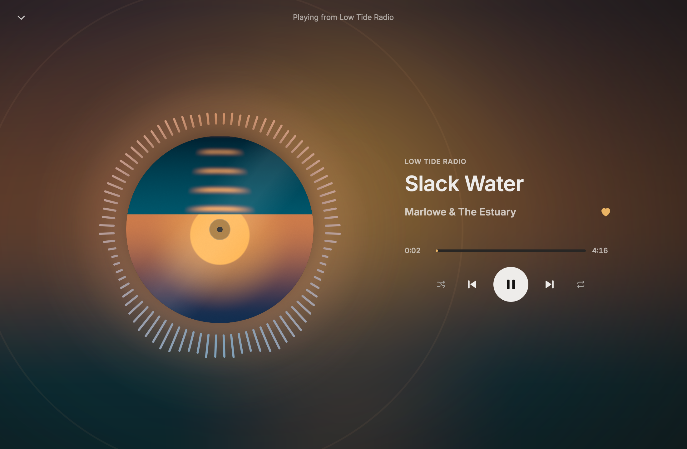

# Baliset

A native Spotify client for Linux, built with [Rune](https://github.com/anomalyco/rune) and
[librespot](https://github.com/librespot-org/librespot). It needs a Spotify Premium account
and a network connection; nothing is downloaded for offline use.

- Shows up as a Spotify Connect device ("Baliset (hostname)"), so the phone app and other
  clients can play to it and control it.
- Main window: recents, saved albums, playlists, Liked Songs, artist and album pages, search.
- Podcasts: followed shows, Your Episodes and show pages (audio only). The sidebar's library
  switches between playlists, podcasts and followed artists; shows and artists can be followed
  from their pages. Baliset remembers where you left episodes it played and picks up there.
- Closing the window keeps the app in the tray. A click on the tray icon shows or hides the
  window; its menu has play, next and previous.
- MPRIS (`org.mpris.MediaPlayer2.baliset`): media keys, `playerctl` and shell media widgets.
- Right-click a track (or press the Menu key or Shift+F10 on a track list) for Play, Add to
  queue, Go to song radio, Add to playlist, Liked Songs, Go to album and Go to artist; on your
  own or collaborative playlists, Remove from this playlist too. Cards have Play and Shuffle play.
- Up next: the queue button in the now-playing bar opens a panel with the playing track, what
  you queued and what the context plays next. Double-click a row to skip to it.
- Shuffle beside Play on album, playlist, Liked Songs and artist pages; artist pages also have
  the artist's radio.


## Run

```sh
nix run .            # or: nix build . && result/bin/baliset
baliset --demo       # canned data, no account, no sound
```

The first launch shows a sign-in screen. It opens Spotify's sign-in page in the browser and
waits for it to come back to `http://127.0.0.1:5588/login`. The saved sign-in lives in
`~/.local/share/baliset/` (owner-only), with `episodes.json`, where episodes were left. The
sign-out button sits beside your name at the bottom of the sidebar. Audio is cached in
`~/.cache/baliset/audio`, up to 2 GB.

Keys: Space play/pause, Ctrl+L or Ctrl+K search, Ctrl+Left/Right previous/next, Ctrl+W close
to tray, Ctrl+Q quit, Ctrl+= or Ctrl++ zoom in, Ctrl+- zoom out, Ctrl+0 back to 100%.

## Settings

The sliders button beside your name at the bottom of the sidebar opens the settings: audio
quality (Low 96, Normal 160 or Very high 320 kbit/s, the default), evening out loudness
between tracks, and the zoom. librespot fixes the bitrate and loudness setting when its player
starts, so changes to those apply the next time Baliset starts; the zoom applies at once.
Zoom goes from 80% to 200% in a browser's steps and is remembered. Zooming in stops where the
layout would get smaller than 720×480 points, so the default window goes to 150% and a larger
one further; the zoom indicator says when that happens.

Settings live in `~/.config/baliset/settings.json` (`$XDG_CONFIG_HOME` if set), rewritten
whole on each change. A missing file or a value that doesn't fit falls back to its default,
and keys this version doesn't know are kept.

## When something looks broken

```sh
baliset --check          # one line per Spotify service the app uses
baliset --check --json   # the same as JSON
```

`--check` signs in with the saved sign-in, without showing up as a Connect device and
without playing anything, and makes one cheap read-only call to every service Baliset reads:
the profile, playlists, a playlist's tracks, track, album and artist metadata, Liked Songs and
saved albums, listening history, search, song radio and stations, followed shows, saved
episodes, followed artists, show and episode metadata, and where a track's audio file is and
its key. Each line says PASS or FAIL, the call and how long it took; a failure adds the error,
what in the app depends on it and which source file makes the call. It checks that each
answer still reads the way the app reads it, not only that it came back, since a changed
format is the likely breakage. The first line has the versions of Baliset, librespot and Rune,
and the output holds no tokens, account names or ids, only counts, so it can go into a bug
report as is. It exits 0 only when every check passed.

```
baliset 0.1.0 · librespot 0.8.0 · rune 60df96d0142c
PASS  session connect               AP   login with the saved credentials        1313 ms  signed in
PASS  playlist list (rootlist)      GET  /playlist/v2/user/{user}/rootlist        138 ms  49 playlists, 49 named
…
PASS  audio key                     AP   audio key request (track, file)          114 ms  granted
all 20 checks passed
```

To cover a new endpoint, append an entry to `CHECKS` in `src/engine/spotify/check.rs`.

## Visualizers

Album and playlist pages sit in slow pools of the cover's colours that drift and swell with
the music. The expand button at the right of the now-playing bar, or Ctrl+E, opens the Stage, a
full-window player: the blurred cover behind, the art turning as a disc inside a spectrum ring,
the track, seek bar and transport beside it. Esc, Ctrl+E or the collapse button closes it.



The music comes from a tap between librespot's player and the sound card, taken before the
volume, so a muted player still drives them. The analysis runs only while one of them is on
screen in a visible window and something plays; paused, hidden or elsewhere, nothing runs. The
demo engine feeds them a simulated track. `baliset-engine` has a `levels SECONDS` command that
prints what the analysis hears.

## Develop

```sh
nix develop -c cargo test
nix develop -c cargo clippy --all-targets
nix develop -c cargo run -- --demo
nix develop -c cargo run -- --snap home.png --scene home   # headless render; --list-scenes
nix develop -c cargo run --bin baliset-engine               # the engine alone, driven from stdin
nix develop -c cargo run -- --check                        # check every Spotify service the app uses
```

- `src/model.rs`: the store the UI draws and the commands it sends.
- `vendor/librespot-connect`: librespot's Connect crate with one fix of ours (see its README).
- `src/engine/`: the engine handle, a demo backend, and `spotify/`, the real one.
- `src/ui/`, `src/tray.rs`, `src/mpris.rs`: windows, tray icon and MPRIS.
- `vm/`: a headless QEMU VM of the dotfiles desktop for testing on niri (`vm/README.md`).

## How it talks to Spotify

Playback and the Connect device are librespot. The library (playlists, Liked Songs, saved
albums, listening history, metadata, search) is read through the same session, from the
services librespot and the official client use. Spotify's public Web API is not used: it
answers this kind of sign-in with a blanket 429. The queue goes through Spotify Connect: queue commands are sent to this device the way another
client would send them, and what plays next is read back from the account's Connect state.
Playlist edits are posted as changes against the playlist's revision, as the official client
does. These services are not a documented API, so
a Spotify change can break the library views until librespot or Baliset catches up.
