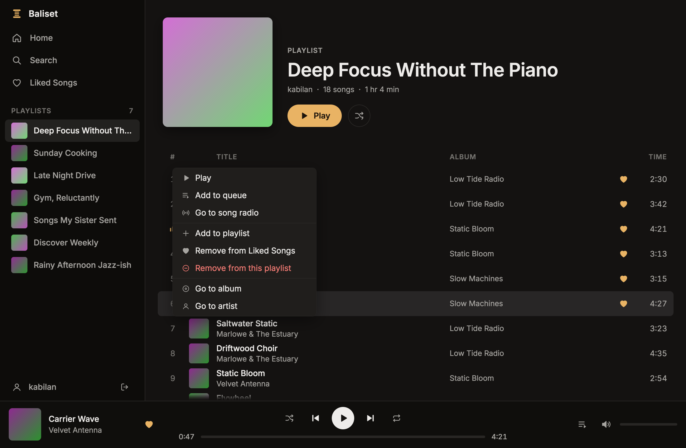
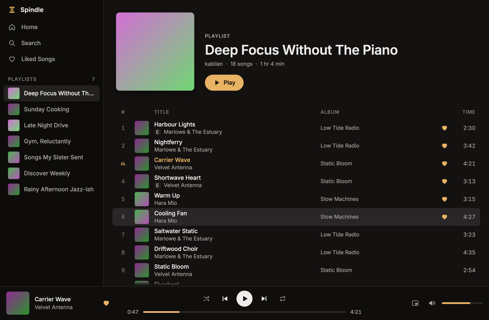

# Baliset

A native Spotify client for Linux, built with [Rune](https://github.com/anomalyco/rune) and
[librespot](https://github.com/librespot-org/librespot). It needs a Spotify Premium account
and a network connection; nothing is downloaded for offline use.

- Shows up as a Spotify Connect device ("Baliset (hostname)"), so the phone app and other
  clients can play to it and control it.
- Main window: recents, saved albums, playlists, Liked Songs, artist and album pages, search.
- Closing the window keeps the app in the tray. A click on the tray icon shows or hides the
  window; its menu has play, next and previous.
- MPRIS (`org.mpris.MediaPlayer2.baliset`): media keys, `playerctl` and shell media widgets.
- Right-click a track (or press the Menu key or Shift+F10 on a track list) for Play, Add to
  queue, Go to song radio, Add to playlist, Liked Songs, Go to album and Go to artist; on your
  own or collaborative playlists, Remove from this playlist too. Cards have Play and Shuffle play.
- Up next: the queue button in the now-playing bar opens a panel with the playing track, what
  you queued and what the context plays next. Double-click a row to skip to it.
- Shuffle beside Play on album, playlist, Liked Songs and artist pages; artist pages also have
  the artist's radio.





## Run

```sh
nix run .            # or: nix build . && result/bin/baliset
baliset --demo       # canned data, no account, no sound
```

The first launch shows a sign-in screen. It opens Spotify's sign-in page in the browser and
waits for it to come back to `http://127.0.0.1:5588/login`. The saved sign-in lives in
`~/.local/share/baliset/` (owner-only). The sign-out button sits beside your name at the
bottom of the sidebar. Audio is cached in
`~/.cache/baliset/audio`, up to 2 GB.

Keys: Space play/pause, Ctrl+L or Ctrl+K search, Ctrl+Left/Right previous/next, Ctrl+W close
to tray, Ctrl+Q quit.

## Develop

```sh
nix develop -c cargo test
nix develop -c cargo clippy --all-targets
nix develop -c cargo run -- --demo
nix develop -c cargo run -- --snap home.png --scene home   # headless render; --list-scenes
nix develop -c cargo run --bin baliset-engine               # the engine alone, driven from stdin
```

- `src/model.rs`: the store the UI draws and the commands it sends.
- `src/engine/`: the engine handle, a demo backend, and `spotify/`, the real one.
- `src/ui/`, `src/tray.rs`, `src/mpris.rs`: windows, tray icon and MPRIS.
- `vm/`: a headless QEMU VM of the dotfiles desktop for testing on niri (`vm/README.md`).

## How it talks to Spotify

Playback and the Connect device are librespot. The library (playlists, Liked Songs, saved
albums, listening history, metadata, search) is read through the same session, from the
services librespot and the official client use. Spotify's public Web API is not used: it
answers this kind of sign-in with a blanket 429. The queue goes through Spotify Connect: queue commands are sent to this device the way another
client would send them, and what plays next is read back from the account's Connect state.
Playlist edits are posted as changes against the playlist's revision, as the official client
does. These services are not a documented API, so
a Spotify change can break the library views until librespot or Baliset catches up.
